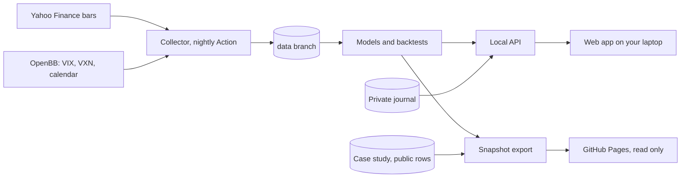

# Apollo Predictor

Apollo is a research tool for trading Micro Nasdaq futures (MNQ) and a few other futures and US stocks, built on free data. It codifies TTrades' Fractal Model, adds a regime detector borrowed from predictive maintenance and a conformal range forecaster, and puts them on a TradingView-style chart with a trading journal. I built it as a follow-up to my [MNQ trading case study](https://github.com/VaughnAntonio/mnq-trading-case-study), to answer the questions that analysis left open with numbers that can't be tidied up afterwards.

Live snapshot, refreshed nightly: **https://vaughnantonio.github.io/Apollo/**


Research tool. Not financial advice.

## How it fits together



A GitHub Action collects bars for 14 symbols every weekday evening and commits them to the `data` branch. On your laptop, a FastAPI service reads those bars, runs the models and keeps the journal in DuckDB. The React app talks only to that local API. A second Action exports a read-only snapshot and publishes it to GitHub Pages; the snapshot's journal holds only the case study's public, scaled trades, so the private journal never leaves the laptop.

The chart has TradingView-style drawing tools: trend lines, rays, horizontal and vertical lines, rectangles and Fibonacci retracements. Drawings are saved per symbol in your browser, on the public site too, and stay in place when you change timeframe.

## Run it

You need Python 3.13 and Node 26. From the repository root:

```bash
python3.13 -m venv .venv && .venv/bin/pip install -e ".[dev]"
```

```bash
npm ci --prefix web
```

Copy the collected bars from the `data` branch into `data_store/`. Your journal there is left alone:

```bash
.venv/bin/python -m apollo.data.sync
```

Then start the API and the web app in two terminals:

```bash
.venv/bin/python -m apollo.api.main
```

```bash
npm --prefix web run dev
```

Open http://localhost:5173. The first forecast of the day takes about half a minute while the models refit; after that it comes from a daily cache. If port 5173 is taken, see [web/README.md](web/README.md).

To load the case study's 51 trades into your journal, clone the case study and run:

```bash
.venv/bin/python -m apollo.journal.importer --csv-dir ../mnq-trading-case-study/data/public
```

In PyCharm Community, open the folder and set the interpreter to `.venv/bin/python` (Settings › Python Interpreter, Ctrl+Alt+S / ⌘,). Add a Python run configuration with module `apollo.api.main` and an npm run configuration for `web/package.json` with the script `dev` (Run › Edit Configurations, Shift+Alt+F10 / ⌃⌥R).

Tests: `.venv/bin/pytest -q` and `npm --prefix web test`.

## Research rigour

- Every forecast is written to a dated ledger between 08:00 and 09:00 ET, before the session, and scored after it. The nightly commit time shows nothing was written late.
- Everything from 2026-08-06 on is a locked holdout. A final test on it runs once, from committed code, with the locked configuration.
- Every research run is logged in `runs/log.csv` and every backtest in `runs/backtests.csv`, so the number of attempts behind a result is public.
- Each filter is tested by switching it on and off (the ablation), and each model is scored against simple baselines.
- Backtests report a 95% bootstrap range on expectancy and a prop-firm Monte Carlo of passing or breaching an evaluation account.
- The Models page lists every session left out of the data and why.

## Results so far

These are development numbers on MNQ, not the holdout.

- The plain Fractal Model took 14 trades from November 2024 to July 2026, with an expectancy of −0.36R (95% range −0.74R to +0.07R) and a 21% win rate. Holding 1 contract over the same dates made $14,001.
- The regime detector does not beat its simplest baseline yet: a log-loss of 1.443 against 1.303 for predicting each regime at its share so far.
- The range forecaster's bounds held on 88.4% of 207 sessions, against a 90% target, and broke most often on trend days.

The model cards have the details: [regime detector](docs/model-card-regime.md), [range forecaster](docs/model-card-range.md) and [the codified Fractal Model](docs/model-card-fractal.md).

## Limitations

- Free data. Yahoo's bars are delayed, hourly history goes back two years and 5-minute history only 60 days, so the 1H-5m layer has no development trades yet.
- Small samples. Fourteen trades and a few hundred sessions can't separate a small edge from noise.
- The 4H chart is built from hourly bars, and so is MCL's daily chart, because Yahoo keeps no daily history for MCL.
- The rules are one reading of a discretionary method. A setup confirmed outside the entry window is entered at the next session's open, and only if neither the stop nor the target was hit in between.

## Credits

The Fractal Model is TTrades' method; Apollo is my attempt to write it down as rules. Market context comes from OpenBB's keyless providers. Bars come from Yahoo Finance.
